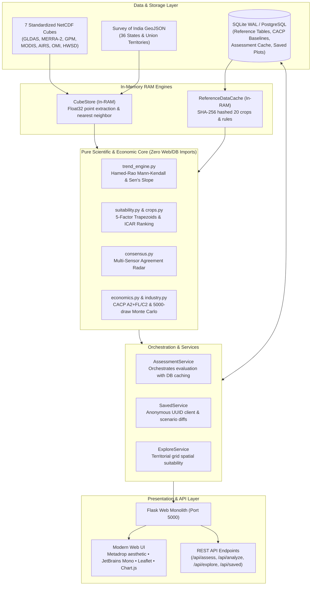

# TeraTrend — Orbital Earth Intelligence & Farm Economics for India

[](https://www.spaceappschallenge.org/)
[](https://www.spaceappschallenge.org/)
[-FF9933?style=for-the-badge)](https://data.gov.in)
[](https://www.python.org/)
[](https://www.sqlalchemy.org/)
[](#automated-testing--verification)

> **"Will conditions stay good, or are they getting worse?"**  
> TeraTrend bridges multi-decadal NASA Earth observation satellite time series with Government of India (CACP) cost-of-cultivation economics. It delivers high-resolution **5-factor land report cards**, **statistically verified 10-year climatic outlooks**, and **comprehensive farm economics (ROI, break-even, risk of loss)** for any coordinate in India.

---

## Table of Contents
1. [The Problem & Opportunity](#the-problem--opportunity)
2. [What TeraTrend Does](#what-teratrend-does)
3. [The Core Scientific & Economic Pillars](#the-core-scientific--economic-pillars)
4. [NASA & Earth Observation Datasets Used](#nasa--earth-observation-datasets-used)
5. [System Architecture](#system-architecture)
6. [Interactive Web Experience](#interactive-web-experience)
7. [Quickstart Guide](#quickstart-guide)
8. [CLI & Database Operations](#cli--database-operations)
9. [Automated Testing & Verification](#automated-testing--verification)
10. [REST API Reference](#rest-api-reference)
11. [NASA DAAC Data Citations](#nasa-daac-data-citations)
12. [License & Disclaimers](#license--disclaimers)

---

## The Problem & Opportunity

Over 140 million farm holdings across India face increasing climate volatility: shifting monsoon onsets, intense thermal heatwaves, groundwater depletion, and erratic unseasonal precipitation. 

Traditional weather apps provide **7-day seasonal forecasts** — useful for tomorrow's spray, but useless for multi-year capital investments such as crop selection, borewell installation, or soil reclamation. Meanwhile, satellite earth science repositories contain petabytes of historical observations that remain locked behind complex HDF5/NetCDF scientific formats, inaccessible to farmers, Farmer Producer Organisations (FPOs), and agricultural lenders.

**TeraTrend solves this gap.** It acts as an **Earth System Trend Detective**:
- Evaluates 15–20 years of continuous NASA satellite observations.
- Uses autocorrelation-corrected trend detection (**Hamed-Rao Modified Mann-Kendall**) to distinguish true climatic degradation from random weather noise.
- Directly translates physical trends into financial viability using official Ministry of Agriculture **CACP benchmark economics** (A2+FL and C2 cost structures).

---

## What TeraTrend Does

When a user selects any location in India (via interactive map click, lat/lon coordinate, or place-name search):

```
       [ Satellite Telemetry ]                 [ Ground Truth ]
NASA GLDAS • MERRA-2 • GPM • MODIS        Survey of India Boundaries
   AIRS • Aura OMI • ORNL HWSD             CACP Costs • ICAR Agronomics
                │                                       │
                └───────────────┬───────────────────────┘
                                ▼
                   ┌─────────────────────────┐
                   │   TeraTrend Platform    │
                   └────────────┬────────────┘
                                │
        ┌───────────────────────┴───────────────────────┐
        ▼                                               ▼
[ 5-Factor Land Report Card ]               [ CACP Crop Economics ]
• Temperature (Score 0-100)                 • Benchmark Yield & Expected Q/ha
• Moisture & Root Wetness                   • Paid-out Cost (A2+FL) vs Full Cost (C2)
• Soil pH (Topsoil & Subsoil)               • Projected Revenue & Net Profit / ha
• Soil Quality (OC%, CEC, Texture)          • ROI % & Return per Day
• Climate & Growing Season                  • Break-even Yield & Price
• 10-Year Statistically Verified Outlook    • 5,000-Draw Monte Carlo Risk of Loss
• Limiting Factor Diagnostics               • Sensitivity Matrix (±10% Price/Yield)
```

---

## The Core Scientific & Economic Pillars

### 1. 5-Factor Land Suitability Scoring
Every coordinate is evaluated across five fundamental agronomic dimensions using continuous trapezoidal membership functions calibrated to Indian agro-climatic conditions:
- **Temperature (20% weight):** Mean annual temperature, extreme heat-stress days, and seasonal temperature amplitude.
- **Moisture (25% weight):** Annual rainfall, root-zone wetness (NOAH layer 2 & MERRA-2), and dry spell frequency. Supports rainfed vs. irrigated toggle.
- **Soil pH (15% weight):** Topsoil and subsoil pH with automatic triggers for agricultural amendments (agricultural lime for acidic soils; gypsum for sodic soils).
- **Soil Quality (20% weight):** Organic Carbon (OC%), Cation Exchange Capacity (CEC), USDA soil texture class, drainage class, salinity ($EC_e$), and sodicity (ESP).
- **Climate & Growing Window (20% weight):** Length of favorable growing season, monsoon concentration, interannual rainfall CV, and thermal stress.
- **Strict Poor Factor Cap:** If *any* individual factor scores in the **POOR** range (<40/100), the overall score is strictly capped at **69.0/100 (MODERATE)** to prevent high performance in one variable from masking an agronomic fatal flaw.

### 2. Hamed-Rao Modified Mann-Kendall Trend Detection
Ordinary Mann-Kendall trend tests suffer from false-positive bias when applied to hydro-meteorological time series due to positive autocorrelation (serial persistence across months and years). TeraTrend implements the **Hamed & Rao (1998) Modified Mann-Kendall test**:
- Calculates the empirical autocorrelation structure up to lag-$k$.
- Computes the variance correction factor $\frac{n}{n^*}$ to adjust the variance of the Mann-Kendall test statistic $S$.
- Computes **Sen's robust non-parametric slope estimator** ($\beta$) and 10-year climatic outlooks.
- **Strict $p < 0.05$ Gate:** The system only issues crop-shift or adaptation recommendations if a trend is statistically verified ($p < 0.05$). If $p \ge 0.05$, the system explicitly advises *"Conditions Stable (No Significant Trend) — Maintain standard rotation."*

### 3. Multi-Satellite Sensor Consensus
To ensure high evidence confidence, TeraTrend cross-evaluates overlapping satellite sensors:
- **Temperature:** GLDAS Noah 0.25° vs. MERRA-2 0.5° vs. AIRS Level 3.
- **Rainfall:** GLDAS Noah vs. MERRA-2 vs. GPM IMERG Final Run v07.
- **Consensus Tiers:** Evaluated as `STRONG` (all sensors agree in sign, slope magnitude, and significance), `MODERATE`, `WEAK`, `CONFLICTING` (sensors disagree), or `SINGLE_SOURCE`.

### 4. CACP Farm Economics & Risk Engine
Unlike standard agronomic tools that stop at suitability ratings, TeraTrend integrates official cost of cultivation benchmarks from the **Commission for Agricultural Costs and Prices (CACP)** and the **Directorate of Economics and Statistics (DES)**:
- **Dual Cost Basis:**
  - **A2+FL:** Actual paid-out expenses (seeds, fertilizers, manure, pesticides, hired human labour, bullock/machine labour, irrigation, interest) plus imputed value of unpaid family labour.
  - **C2 (Comprehensive Cost):** A2+FL plus imputed rental value of owned land and interest on owned fixed capital assets.
- **Financial Metrics:** Gross revenue, net profit/loss per hectare, Return on Investment (ROI %), Benefit-Cost Ratio (BCR), and net return per day.
- **Margin of Safety:** Percentage difference between expected market/MSP price and break-even cost price.
- **Monte Carlo Risk Analysis:** 5,000-draw stochastic simulation modeling lognormal yield and price uncertainty with negative yield-price elasticity correlation ($r = -0.20$), calculating the **Probability of Loss (%)** and P10/P50/P90 return distributions.

### 5. Sovereign India Territorial Scope
- **Coverage:** 100% compliant with the official territory of the Republic of India as depicted by the Survey of India, encompassing all 28 States and 8 Union Territories (including Jammu & Kashmir, Ladakh, Arunachal Pradesh, Andaman & Nicobar Islands, and Lakshadweep).
- **Spatial Grid:** 5,107 analysis cells at 0.25° (~27 km) resolution (`backend/data/processed/india_grid.nc`).
- **Clean Fallback:** Nearest-neighbor land search with a strict 30 km radius for coastal and island points.

---

## NASA & Earth Observation Datasets Used

| Sensor / Mission | Collection | Provider / DAAC | Spatial / Temporal Res | TeraTrend Indicator |
| :--- | :--- | :--- | :--- | :--- |
| **GLDAS Noah Land Surface** | `GLDAS_NOAH025_M` v2.1 | NASA GES DISC | 0.25° / Monthly (2010–2024) | Air Temperature, Rainfall Flux, Root Soil Moisture, Evapotranspiration |
| **MERRA-2 Reanalysis** | `M2TMNXSLV` / `FLX` / `LND` v5.12.4 | NASA GMAO / GES DISC | 0.50° / Monthly (2010–2024) | 2m Temperature, Corrected Precipitation, Evaporation, Root Wetness |
| **GPM IMERG** | `GPM_3IMERGM` v07 | NASA GES DISC | 0.10° / Monthly (2010–2024) | Multi-satellite Calibrated Precipitation Rate |
| **MODIS Terra/Aqua** | `MOD13C2` v061 | NASA LP DAAC | 0.05° / Monthly (2010–2024) | NDVI Vegetation Health, EVI, Pixel Reliability |
| **AIRS Atmospheric Sounder** | `AIRS3STM` v7.0 | NASA GES DISC | 1.00° / Monthly (2010–2024) | Surface Skin / Air Temperature, Relative Humidity |
| **Aura OMI** | `OMNO2d` / `OMTO3d` v003 | NASA GES DISC | 0.25° / Daily to Monthly (2010–2024) | Tropospheric NO₂ Cloud-screened Column Density |
| **Harmonized World Soil (HWSD)** | `HWSD_1247` v1.2 | NASA ORNL DAAC / FAO / IIASA | 0.05° / Static Calibrated NetCDF | Topsoil & Subsoil pH, Organic Carbon, CEC, Soil Texture, Drainage, Salinity |

---

## System Architecture

TeraTrend follows a **Clean Hexagonal Architecture**: scientific numerical engines and agronomic models are completely pure (zero dependencies on web frameworks or databases), hydrated via in-memory dependency injection.



---

## Interactive Web Experience

The web application is structured into **four purposeful pages**:

1. **Landing Page (`/`):** Clean editorial layout featuring live NASA telemetry status, feature overview, core value proposition, and quick links.
2. **Decision Engine (`/decision`):**
   - Click-to-query interactive Leaflet map of India with district boundaries.
   - 5-factor Land Report Card with GOOD / MODERATE / POOR badges and 10-year outlook.
   - Ranked suited crops and clear misfits with limiting factor diagnostics.
   - Interactive CACP Economics Workspace: toggle **A2+FL** vs. **C2**, switch between Market and MSP price bases, and test sandbox sliders (Yield, Market Price, Cultivation Cost).
3. **Trend Explorer (`/explorer`):**
   - 15-year multi-sensor time series visualization with Chart.js.
   - Indicator picker (Temperature, Rainfall, Root Moisture, Evapotranspiration, NDVI, NO₂).
   - Sensor toggle (GLDAS vs. MERRA-2 vs. GPM vs. MODIS vs. AIRS).
   - Real-time Hamed-Rao Mann-Kendall statistics table ($Z$-score, $p$-value, Sen's slope, $\tau$, autocorrelation variance correction).
4. **Methodology & Science (`/methodology`):**
   - Complete technical whitepaper detailing the mathematical formulas, trapezoidal scoring boundaries, CACP cost components, and NASA DAAC citations.

---

## Quickstart Guide

### Prerequisites
- Python 3.10+ (tested on Python 3.14)
- Git

### 1. Clone & Set Up Virtual Environment
```bash
git clone https://github.com/your-username/teratrend.git
cd teratrend

# Create and activate virtual environment
python -m venv venv

# On Windows:
.\venv\Scripts\Activate.ps1
# On macOS / Linux:
source venv/bin/activate

# Install dependencies
pip install -r backend/requirements.txt
```

### 2. Generate NetCDF Cubes & Initialize Database
```bash
# On Windows (PowerShell):
$env:PYTHONPATH="backend"
python -m pipeline.generate_demo_cubes
python -m db.cli init
python -m db.cli seed
python -m db.cli precompute-grid --limit 150

# On Linux / macOS:
export PYTHONPATH=backend
python -m pipeline.generate_demo_cubes
python -m db.cli init
python -m db.cli seed
python -m db.cli precompute-grid --limit 150
```

### 3. Launch the Application
```bash
# On Windows (PowerShell):
$env:PYTHONPATH="backend"
python backend/app.py

# On Linux / macOS:
PYTHONPATH=backend python backend/app.py
```

Open your browser to: **[http://127.0.0.1:5000](http://127.0.0.1:5000)**

---

## CLI & Database Operations

TeraTrend provides a unified management CLI via `python -m db.cli`:

| Command | Description |
| :--- | :--- |
| `python -m db.cli init` | Run Alembic migrations and verify schema. |
| `python -m db.cli seed` | Seed reference tables and CACP economic baselines from JSON. |
| `python -m db.cli export` | Export database tables back into JSON format for versioning. |
| `python -m db.cli check` | Run integrity checks, coverage matrix, and generate `DATA_GAPS.md`. |
| `python -m db.cli backup` | Execute hot SQLite online backup to `backend/data/backups/`. |
| `python -m db.cli prune-cache --max-rows 1000` | Prune least-recently-accessed assessment cache rows. |
| `python -m db.cli precompute-grid --limit 200` | Precompute spatial suitability scores across the territorial grid. |

---

## Automated Testing & Verification

TeraTrend includes an extensive automated test suite covering pure numerical algorithms, spatial containment, AST import purity, database repositories, caching, and REST endpoints.

```bash
# Run full test suite with verbose output
$env:PYTHONPATH="backend"
python -m pytest backend/tests/ -v
```

### Test Coverage Highlights:
- **`test_purity.py`:** Statically parses AST trees to guarantee pure scientific modules import zero SQLAlchemy or Flask modules.
- **`test_trend_engine.py`:** Validates Hamed-Rao autocorrelation correction against synthetic known trends and white noise.
- **`test_economics.py`:** Validates deterministic Monte Carlo draws, A2+FL vs. C2 cost calculations, and sensitivity tables.
- **`test_geo.py` & `test_regions.py`:** Verifies Point-in-Polygon containment for Survey of India boundaries and strict out-of-bounds rejection.
- **`test_db_integration.py`:** Verifies end-to-end database lifecycle (anonymous sessions, cache hit/miss, scenario snapshots, rerun diffs).

---

## REST API Reference

| Endpoint | Method | Params | Description |
| :--- | :--- | :--- | :--- |
| `/api/health` | `GET` | — | Returns system operational status, loaded NetCDF cubes, and RAM usage. |
| `/api/assess` | `GET` | `lat`, `lon`, `crop`, `season`, `irrigation` | Comprehensive 5-factor land card, ranked crops, and CACP economics. |
| `/api/analyze` | `GET` | `lat`, `lon`, `indicator`, `source` | 15-year annual time series, Hamed-Rao Mann-Kendall statistics, and Sen's slope. |
| `/api/consensus` | `GET` | `lat`, `lon`, `group` | Multi-sensor agreement level (e.g. temperature, rainfall) across satellites. |
| `/api/crops` | `GET` | — | Registry of all 20 supported Indian crops and agronomic constraints. |
| `/api/explore/best-places` | `GET` | `crop`, `state`, `limit` | Top precomputed grid cells with highest suitability and ROI for a crop. |
| `/api/explore/state-summary` | `GET` | `crop` | Average and peak suitability scores grouped by Indian state. |
| `/api/saved/locations` | `GET`, `POST` | `label`, `lat`, `lon` | Anonymous cookie-backed storage for farmers' saved fields. |
| `/api/saved/scenarios` | `GET`, `POST` | `location_id`, `crop_key`, `options` | Save economic scenario snapshots. |
| `/api/saved/scenarios/<id>/run` | `POST` | — | Rerun scenario against latest telemetry and calculate change diffs. |

---

## NASA DAAC Data Citations

1. **GLDAS Noah Land Surface Model:** Rodell, M., et al. (2004), *The Global Land Data Assimilation System*, Bull. Amer. Meteor. Soc., 85(3), 381–394. DOI: [10.5067/9VO19KM6ZTR3](https://doi.org/10.5067/9VO19KM6ZTR3). NASA GES DISC.
2. **MERRA-2 Reanalysis:** Gelaro, R., et al. (2017), *The Modern-Era Retrospective Analysis for Research and Applications, Version 2 (MERRA-2)*, J. Climate, 30(14), 5419–5454. DOI: [10.5067/0J5VGDOSB07B](https://doi.org/10.5067/0J5VGDOSB07B). NASA GES DISC.
3. **GPM IMERG Precipitation:** Huffman, G. J., et al. (2019), *GPM IMERG Final Precipitation L3 1 month 0.1 degree x 0.1 degree V07*, NASA GES DISC. DOI: [10.5067/GPM/IMERG/3B-MONTH/07](https://doi.org/10.5067/GPM/IMERG/3B-MONTH/07).
4. **MODIS Vegetation Indices:** Didan, K. (2021), *MODIS/Terra Vegetation Indices Monthly L3 Global 0.05Deg CMG V061*, NASA LP DAAC. DOI: [10.5067/MODIS/MOD13C2.061](https://doi.org/10.5067/MODIS/MOD13C2.061).
5. **AIRS Atmospheric Sounder:** AIRS project (2019), *Aqua/AIRS L3 Monthly Standard Physical Retrieval (AIRS-only) 1 degree x 1 degree V7.0*, NASA GES DISC. DOI: [10.5067/AIRS/AIRS3STM.007](https://doi.org/10.5067/AIRS/AIRS3STM.007).
6. **Aura OMI Tropospheric NO₂:** Krotkov, N. A., et al. (2019), *OMI/Aura NO2 Cloud-Screened Total and Tropospheric Column L3 1 day 0.25 degree V003*, NASA GES DISC. DOI: [10.5067/Aura/OMI/DATA3007](https://doi.org/10.5067/Aura/OMI/DATA3007).
7. **Harmonized World Soil Database:** Wieder, W. R., et al. (2014), *Regridded Harmonized World Soil Database v1.2*, ORNL DAAC. DOI: [10.3334/ORNLDAAC/1247](https://doi.org/10.3334/ORNLDAAC/1247).
8. **Cost of Cultivation Economics:** Directorate of Economics and Statistics & Commission for Agricultural Costs and Prices (CACP), Ministry of Agriculture & Farmers Welfare, Government of India.

---

## License & Disclaimers

- **Scientific & Software License:** Distributed under the MIT License.
- **Boundary Disclaimer:** All administrative state and district boundary layers are strictly compliant with the official political map of the Government of India (Survey of India).
- **Advisory Disclaimer:** TeraTrend provides indicative geospatial decision support and risk estimates for farm planning. It does not constitute financial guarantees of crop yields or market prices. Agricultural decisions should combine TeraTrend insights with on-ground soil testing and local Krishi Vigyan Kendra (KVK) extension recommendations.
