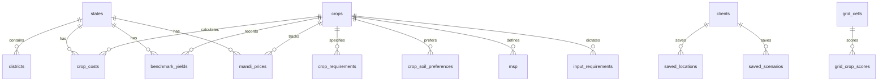

# TeraTrend Backend

> **Geospatial Agricultural Decision Support for India (NASA Space Apps Challenge 2026: *"Be An Earth System Trend Detective!"*)**

TeraTrend is a high-performance Python backend that evaluates land suitability and enterprise crop economics for any location across India. It synthesizes multi-decadal NASA Earth observation time series, reanalysis models, global soil databases, and official Government of India agricultural economics into actionable farm-level insights.

When a user provides coordinates or an Indian location name, TeraTrend delivers:
1. **Land Report Card:** Five foundational agricultural suitability factors (**temperature, moisture, soil pH, soil quality, climate**), each rated `GOOD`, `MODERATE`, or `POOR` (0–100 score) with measured values, ideal ranges, plain-language explanations, Hamed-Rao Modified Mann-Kendall trends, and 10-year climate outlooks.
2. **Multi-Dataset Consensus:** Cross-validation across independent satellite missions and reanalysis datasets (GLDAS, MERRA-2, GPM IMERG, MODIS Terra, AIRS, OMI) on strictly overlapping observation years.
3. **Enterprise Crop Economics:** Comprehensive financial viability analysis for 20 principal Indian crops based on official CACP cost concepts (**A2**, **A2+FL**, **C2**), DES benchmark yields, Agmarknet mandi prices, DA&FW Minimum Support Prices (MSP), deterministic lognormal Monte Carlo risk modeling (5,000 draws), sensitivity tornadoes, and balanced crop recommendations.

---

## 1. Scope & Sovereign India Territory

- **Coverage:** TeraTrend strictly covers sovereign Indian territory as officially depicted by the Government of India (Survey of India), including all 28 States and 8 Union Territories (Jammu & Kashmir, Ladakh, Andaman & Nicobar Islands, Lakshadweep, Arunachal Pradesh, Puducherry enclaves, and Dadra & Nagar Haveli and Daman & Diu).
- **Boundary Verification:** Driven by `data/boundaries/india_states.geojson` sourced from Survey of India-compliant redistributions (DataMeet maps, ODbL / CC-BY 2.5). Every query is validated via Shapely 2.0 STRtree point-in-polygon queries against the exact coordinate. Coordinates outside India immediately return HTTP 422 with error code `OUT_OF_INDIA`.
- **Coastal & Island Fallback:** Atmospheric datasets (MERRA-2, GPM, AIRS, OMI) cover island and coastal cells directly. For land-surface layers (GLDAS soil moisture, HWSD soil properties, MODIS vegetation) that mark small island or coastal cells as water, TeraTrend searches for the nearest valid land cell within `MAX_LAND_FALLBACK_KM = 30 km`. Beyond 30 km, the layer is marked `NO_DATA`, factor weights are renormalized, overall confidence is adjusted, and transparent coverage notes are returned.
- **Crop Scope:** Field crops, cereals, coarse grains, pulses, oilseeds, fibre, and short-duration commercial crops. **Perennial plantation crops (tea, coffee, rubber, coconut, arecanut) and commercial orchard trees are explicitly out of scope.**

---

## 2. NASA & Soil Datasets

All dynamic datasets span from 2005 through the latest complete year available. Raw files are regridded to the canonical **0.25° x 0.25° India Grid** (6.0°N–38.0°N, 68.0°E–98.0°E, 5,107 valid terrestrial cells) stored in `data/processed/india_grid.nc`.

| Dataset Key | NASA Collection / Short Name | Version | Provider / DAAC | Native Grid | Variables Extracted | Common Grid Method |
|---|---|---|---|---|---|---|
| `gldas` | `GLDAS_NOAH025_M` | v2.1 | GES DISC | 0.25° | `Tair_f_inst`, `Rainf_f_tavg`, `SoilMoi0_10cm_inst`, `SoilMoi10_40cm_inst`, `Evap_tavg` | Bilinear (canonical mesh) |
| `merra2` | `M2TMNXSLV`, `M2TMNXFLX`, `M2TMNXLND` | v5.12.4 | GES DISC | 0.5° x 0.625° | `T2M`, `PRECTOTCORR`, `EVAP`, `GWETROOT`, `GWETTOP` | Bilinear interpolation |
| `gpm` | `GPM_3IMERGM` (Final Run) | v07 | GES DISC | 0.1° | `precipitation` | Conservative coarsen (factor 2.5) |
| `modis` | `MOD13C2` (Terra CMG) | v061 | LP DAAC | 0.05° | `CMG 0.05 Deg Monthly NDVI`, `EVI` | Coarsen (factor 5, >=50% valid rule) |
| `airs` | `AIRS3STM` | v7.0 | GES DISC | 1.0° | `SurfAirTemp_A/D`, `SurfAirRH_A/D` | Bilinear interpolation |
| `omi` | `OMNO2d`, `OMTO3d` | v003 | GES DISC | 0.25° / 1.0° | `ColumnAmountNO2TropCloudScreened`, `ColumnAmountO3` | Daily-to-monthly (min 10 valid days) |
| `hwsd` | `HWSD_1247` (v1.2 NetCDF) | v1.2 | ORNL DAAC | 30 arc-sec (~1 km) | `T/S_PH_H2O`, `T_OC`, `T_CEC_CLAY`, texture, drainage, salinity, sodicity | Area-mean / Modal categorical |

*Note on ISRIC SoilGrids:* An optional supplemental REST client is available (`ENABLE_SOILGRIDS_LIVE=false` by default). When enabled, SoilGrids values are presented alongside HWSD and clearly labeled "ISRIC SoilGrids (non-NASA)".

---

## 3. Official Agricultural Economics

TeraTrend adheres strictly to official, empirical Indian government publications. **No economic numbers are invented or fabricated.**

- **Cultivation Costs (`data/economics/crop_costs.json`):** Comprehensive CACP cost of cultivation tables with detailed breakdown into 13 cost items, synthesizing:
  - **A2:** Actual paid-out expenses (hired human labour, machine/bullock power, seed, fertilizers, plant protection, irrigation, repairs/interest, rent on leased land).
  - **A2+FL:** A2 plus the imputed value of unpaid family labour.
  - **C2:** Comprehensive cost including A2+FL plus rental value of owned land and interest on fixed capital.
- **Benchmark Yields (`data/economics/benchmark_yields.json`):** State and national 3-to-5-year average yields in quintals/ha from the Directorate of Economics and Statistics (DES), Department of Agriculture & Farmers Welfare (DA&FW).
- **Prices & Procurement (`data/economics/prices.json`):**
  - Minimum Support Prices (MSP) approved by the Cabinet Committee on Economic Affairs (CCEA) for Kharif, Rabi, and Commercial seasons (2024–25 and 2025–26).
  - Mandi modal prices from Agmarknet (data.gov.in) with trailing 12-month averages, annualized volatility coefficients (CV), and 12-month seasonal price indices.
- **Input Requirements & Policy Support:** Seed rates, NPK dosages, season water requirements (mm), and labour man-days from ICAR State Agricultural University packages of practices. Official PMFBY premium rates, Kisan Credit Card interest subventions, and PM-KISAN guidelines.
- **Fallback Hierarchy:** If a crop record is not available at the state level, TeraTrend transparently falls back to the official national average, flags the fallback, and issues a warning. If no data exists, `available: false` is returned with full explanation.

---

## 4. Scientific Core

### Hamed-Rao Modified Mann-Kendall Test
To evaluate trends in auto-correlated climate time series without false positives, TeraTrend uses the Hamed and Rao (1998) modification to the Mann-Kendall test. Effective sample size is corrected for significant empirical lag autocorrelation. The rate of change is quantified using Sen's robust non-parametric slope estimator, reported per year and per decade.
- **Strict Significance Gate:** A trend only influences agronomic adaptation rules if $p < 0.05$. If $p \ge 0.05$, the system returns `STABLE_BASELINE` ("maintain established rotations; do not react to noise").
- **Air Quality Guardrail:** Atmospheric $NO_2$ and $O_3$ provide environmental context only and never trigger crop changes.

### Multi-Dataset Consensus
Consensus is evaluated across available missions on identical overlapping calendar years:
- **STRONG:** All available datasets agree on direction and statistical significance ($p < 0.05$).
- **MODERATE:** Datasets agree on direction, with at least one significant and no opposing significant trends.
- **WEAK:** Concordant direction but none statistically significant.
- **CONFLICTING:** Datasets show statistically significant trends in opposite directions.
- **SINGLE_SOURCE:** Only one dataset available for the group.

### Smooth Trapezoidal Suitability Scoring
Suitability factors and crop agronomic requirements are scored using four-parameter piecewise-linear trapezoids $(T_0, T_1, T_2, T_3)$:
- $x \le T_0$ or $x \ge T_3$: Score 0
- $T_1 \le x \le T_2$: Score 100 (Optimal range)
- Linear ramps between $T_0 \to T_1$ and $T_2 \to T_3$
- **POOR Factor Capping Rule:** If **any** factor scores in the POOR range ($< 40$), the overall suitability score is strictly capped at $\le 69.0$ and rated `MODERATE` or `POOR`, preventing a fertile soil from masking an arid climate or toxic salinity.

### Lognormal Monte Carlo Risk Simulation
Yield and market prices are simulated as correlated lognormal random variables across 5,000 deterministic iterations (seeded from enterprise parameters):
- Yield variation is driven by historical precipitation CV, baseline crop variance, and local suitability.
- Negative yield-price elasticity is preserved ($\rho = -0.20$).
- Outputs $P(\text{loss}) = P(\text{Net Return} < 0)$, $P_{10}$, $P_{50}$ (median), and $P_{90}$ returns.

---

## 5. Architecture & Operational Performance

- **Framework:** Single-server Python monolith powered by Flask. Serves the REST API, Jinja2 dynamic views, and static frontend assets without CORS overhead.
- **In-Memory RAM Store (`CubeStore`):** Pre-loads processed 0.25° NetCDF cubes into RAM cast to `float32`. Total memory footprint is strictly $< 500\text{ MB}$.
- **Query Latency:** Spatial indexing via Shapely STRtree and in-memory slicing delivers sub-400 ms response times for full multi-dataset and economic assessments.

---

## 6. Setup & Installation

### Prerequisites
- Python 3.10+ (tested on Python 3.10 through 3.14)
- A NASA Earthdata Login account ([Register free](https://urs.earthdata.nasa.gov/))
- (Optional) API key for data.gov.in

### 1. Clone & Configure Environment
```bash
git clone https://github.com/your-org/teratrend.git
cd teratrend/backend

# Create virtual environment
python -m venv venv
source venv/bin/activate  # On Windows: venv\Scripts\activate

# Install dependencies
pip install -r requirements.txt

# Configure environment variables
cp .env.example .env
```

Edit `.env` and provide your Earthdata credentials:
```ini
EARTHDATA_USERNAME=your_nasa_username
EARTHDATA_PASSWORD=your_nasa_password
DATAGOVIN_API_KEY=your_datagov_key_optional
```

Alternatively, configure `~/.netrc` (or `_netrc` on Windows):
```text
machine urs.earthdata.nasa.gov login <your_username> password <your_password>
```

---

## 7. Data Pipeline Sequence

The automated pipeline downloads, regrids, and compiles canonical cubes:

```bash
# Step 1: Generate India sovereign boundary grid mask (0.25 deg)
python pipeline/india_grid.py

# Step 2: Download NASA granules via earthaccess (requires Earthdata auth)
python pipeline/download.py --all --start-year 2005 --end-year 2024

# Step 3: Regrid raw granules into canonical processed NetCDF cubes
python pipeline/build_cube.py --all

# Step 4: Validate cube integrity, float32 encoding, coordinate monotonicities
python pipeline/validate_cube.py

# Step 5: Verify official economics freshness and generate DATA_GAPS.md
python pipeline/economics_refresh.py

# Step 6: Start TeraTrend server
python app.py
```

TeraTrend will start at `http://127.0.0.1:5000`.

---

## 8. REST API Reference

### Health & Capabilities
- `GET /api/health`: System status, operational check, loaded cubes, and RAM utilization.
- `GET /api/datasets`: Metadata registry, DOIs, NASA providers, and temporal extent.
- `GET /api/indicators`: Registered agricultural indicators and units.
- `GET /api/crops`: Complete agronomic requirements for all 20 supported Indian crops.
- `GET /api/provenance`: Cryptographic SHA-256 hashes, CMR concept IDs, and citations.

### Location & Regions
- `GET /api/region?lat=21.1458&lon=79.0882`: Resolves administrative State/UT and district. Returns 422 `OUT_OF_INDIA` if outside sovereign borders.
- `GET /api/geocode?q=Nagpur`: OpenStreetMap Nominatim geocoder with 1 req/sec rate limit, in-memory cache, and boundary verification.

### Core Assessment & Decision Support
- `GET /api/assess`: Primary evaluation endpoint.
  - Parameters:
    - `lat` (float, required), `lon` (float, required)
    - `crop` (string, optional, e.g. `wheat`)
    - `irrigation` (string, `rainfed` [default] or `irrigated`)
    - `area_ha` (float, default `1.0`)
    - `tenure` (string, `owned` [default] or `leased`)
    - `cost_basis` (string, `a2_fl` [default] or `c2`)
    - `price_basis` (string, `market` [default] or `msp`)

### Standalone Economics & Scenarios
- `POST /api/economics`: Interactive scenario modeling with custom parameters.
  - JSON Body:
    ```json
    {
      "lat": 21.1458,
      "lon": 79.0882,
      "crop": "wheat",
      "area_ha": 2.5,
      "tenure": "owned",
      "cost_basis": "a2_fl",
      "price_basis": "market",
      "yield_override_q_ha": 42.0,
      "price_override_per_q": 2400.0,
      "cost_multiplier": 1.10
    }
    ```

### Statistical Trend & Multi-Dataset Consensus
- `GET /api/analyze?lat=21.1458&lon=79.0882&indicator=air_temperature&source=gldas`: Full Hamed-Rao test, Sen's slope, $p$-value, standardized change, and 10-year outlook.
- `GET /api/consensus?lat=21.1458&lon=79.0882&group=temperature`: Cross-dataset consensus across GLDAS, MERRA-2, and AIRS on overlapping years.

### Anonymous Farmer Plots & Saved Scenarios
- `GET /api/me`: Anonymous client profile and count of saved locations/scenarios.
- `DELETE /api/me`: Completely purges all stored client data and clears session cookie.
- `GET /api/saved/locations`: List saved farm plots.
- `POST /api/saved/locations`: Save a new location plot (`{ "label": "North Field", "lat": 21.1458, "lon": 79.0882 }`).
- `DELETE /api/saved/locations/<id>`: Delete a saved location.
- `GET /api/saved/scenarios`: List all saved economic scenarios.
- `POST /api/saved/scenarios`: Store an economic assessment scenario snapshot.
- `GET /api/saved/scenarios/<id>`: Fetch single scenario and snapshot payload.
- `POST /api/saved/scenarios/<id>/run`: Re-run scenario against live cubes and return diff comparison against snapshot.
- `DELETE /api/saved/scenarios/<id>`: Delete scenario.

### Spatial Exploration & Precomputed Rankings
- `GET /api/explore/best-places?crop=wheat&state=Punjab&limit=20`: Query top-scoring grid cells for a crop.
- `GET /api/explore/state-summary?crop=wheat`: Average and peak suitability scores grouped by state.

### Administration & Operations (Protected via X-Admin-Token)
- `POST /api/admin/reload-reference`: Hot-reload in-memory reference cache from database.
- `POST /api/admin/cache/clear`: Clear all assessment cache entries.
- `GET /api/admin/data-health`: Table counts, coverage matrix, and unverified data report.

---

## 9. Database Architecture & Migrations

TeraTrend integrates a database layer using **SQLAlchemy 2.0 (typed ORM)** and **Alembic**:



### Key Architectural Decisions
- **Engines:** SQLite by default (`sqlite:///data/teratrend.db` with `PRAGMA foreign_keys=ON; journal_mode=WAL; busy_timeout=5000;`). Production uses PostgreSQL via `DATABASE_URL` (psycopg 3).
- **Clean Architecture Purity:** Pure business logic modules (`trend_engine`, `consensus`, `climatology`, `suitability`, `crops`, `amendments`, `economics`, `industry`, `advisor`, `units`, `regions`) **never import SQLAlchemy or Flask**. They operate purely on dataclasses and dicts supplied via dependency injection. This is enforced by static AST tests in `backend/tests/test_purity.py`.
- **In-RAM Reference Cache:** `ReferenceDataCache` loads all reference data once into RAM at startup, computing a deterministic SHA-256 version hash. `/api/assess` queries 0 database tables per request.
- **Transparent Query Caching:** `/api/assess` automatically caches results in `assessments_cache`. Identical queries return with `"cache": "hit"` in $<30$ ms.
- **Database Management CLI:**
  ```bash
  # Initialize database schema to head migration
  python -m db.cli init

  # Seed agronomic reference & CACP economics data
  python -m db.cli seed

  # Verify database integrity and generate DATA_GAPS.md
  python -m db.cli check

  # Perform hot online backup (SQLite online backup API / pg_dump)
  python -m db.cli backup

  # Prune least recently hit cache entries
  python -m db.cli prune-cache --max-rows 100000

  # Export database back to data/seed/ JSON format
  python -m db.cli export
  ```

---

## 10. Testing & Quality Assurance

TeraTrend includes a complete suite of unit, integration, and database tests. All 104 tests run offline using synthetic mini-cubes:

```bash
python -m pytest backend/tests/ -v
```

**Test Coverage Summary (104 passed tests):**
- `test_purity.py`: Static AST inspection guaranteeing 11 pure modules have 0 imports of `sqlalchemy`, `flask`, or `alembic`.
- `test_db_models.py`: Model constraints (trapezoid ordering check, positive yield constraint, unique codes, cascade deletes).
- `test_migrations.py`: Bidirectional Alembic migration cycle (upgrade head -> downgrade base -> upgrade head).
- `test_seed.py`: Idempotent seed insertion, update logic, row counts, and JSON export.
- `test_repositories.py`: Reference, Economics, Results, Clients, and Grid repositories.
- `test_reference_cache.py`: Startup in-memory cache hydration, SHA-256 reference versioning, and hot reload.
- `test_assessment_cache.py`: Assessment cache miss -> hit flow, sub-50ms cache response, and geocoding cache.
- `test_saved.py`: Anonymous farmer cookie session (`tt_client_id`), plot CRUD, scenario CRUD, and rerun diff comparison.
- `test_admin.py`: Token authorization security (constant-time comparison), reload-reference, clear-cache, data-health.
- `test_explore.py`: Precomputed grid querying for best places and state summaries.
- `test_db_integration.py`: Complete end-to-end database lifecycle.
- Core scientific and agronomic test suite (`test_units.py`, `test_regions.py`, `test_geo.py`, `test_regrid.py`, `test_climatology.py`, `test_trend_engine.py`, `test_consensus.py`, `test_suitability.py`, `test_crops.py`, `test_amendments.py`, `test_advisor.py`, `test_economics.py`, `test_industry.py`, `test_pipeline_sources.py`, `test_provenance.py`, `test_geocode.py`, `test_api.py`).

---

## 11. Scientific Limitations & Disclaimers

1. **Spatial Averaging:** Satellite and reanalysis variables represent ~27 km grid cell averages. Microclimates, localized valleys, and sub-grid topographic variations are smoothed.
2. **Soil Testing Required:** Static soil attributes from HWSD provide regional baselines. Farmers must always perform field-level chemical soil tests before applying fertilizers or amendments.
3. **Indicative Financials:** Projected yields, revenues, and returns are indicative models for farm enterprise planning. They do not constitute financial guarantees. Actual farmer net returns depend on hyper-local input costs, pest outbreaks, weather shocks, and mandi dynamics.
4. **Plantation Crops Out of Scope:** Multi-year plantation trees and perennial orchards are not modeled. TeraTrend focuses strictly on annual, biannual, and short-duration seasonal crops.
